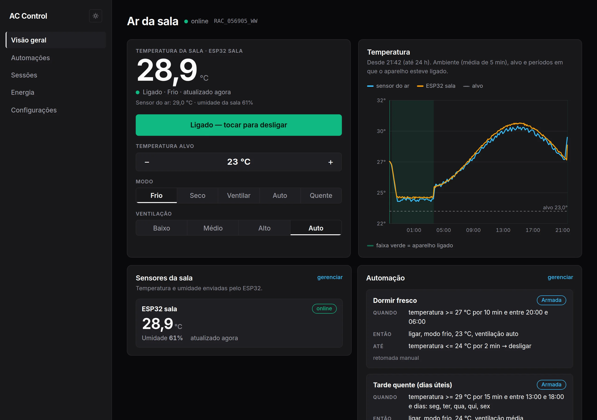
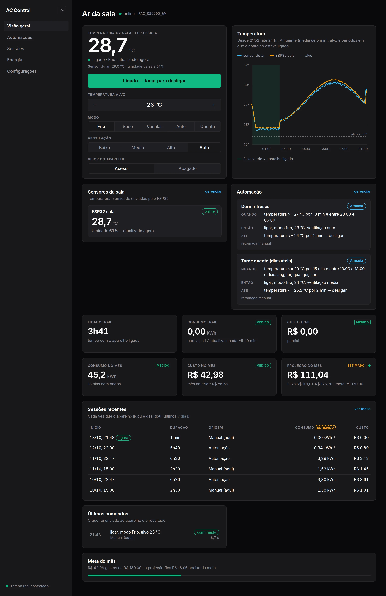
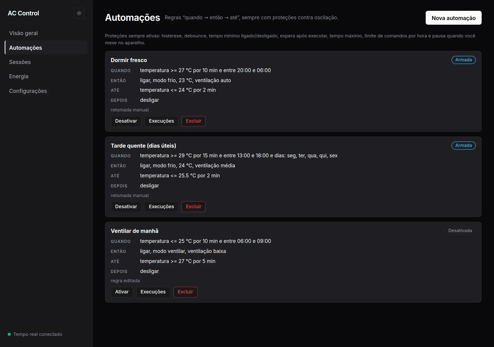
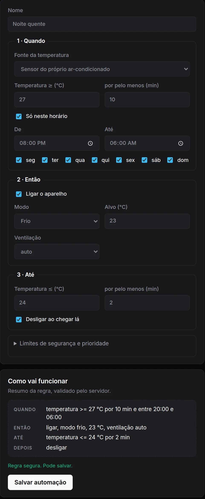
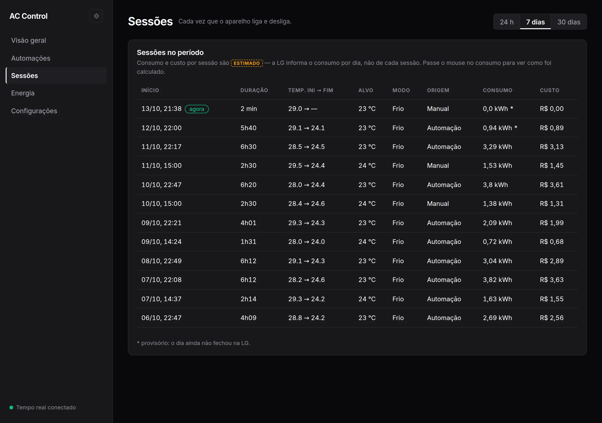
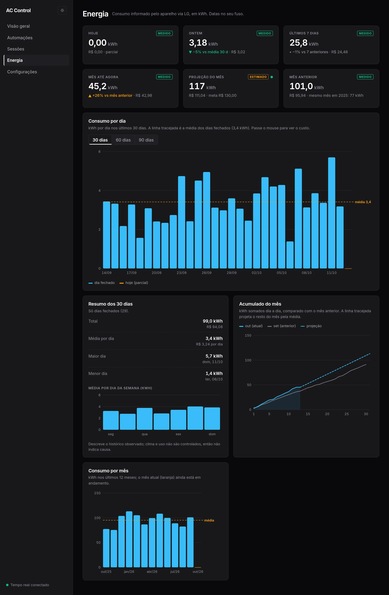
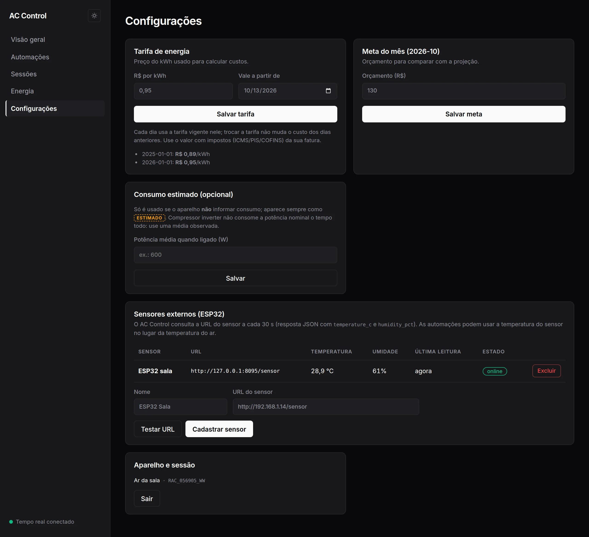
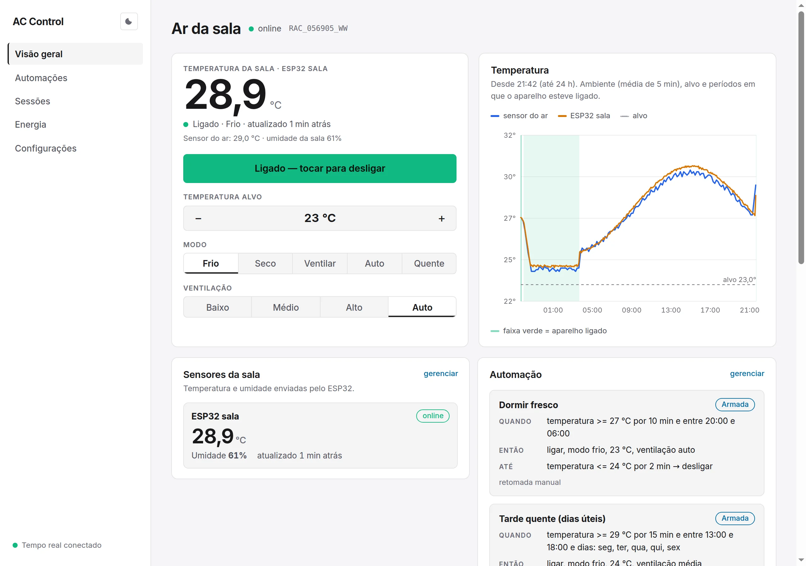
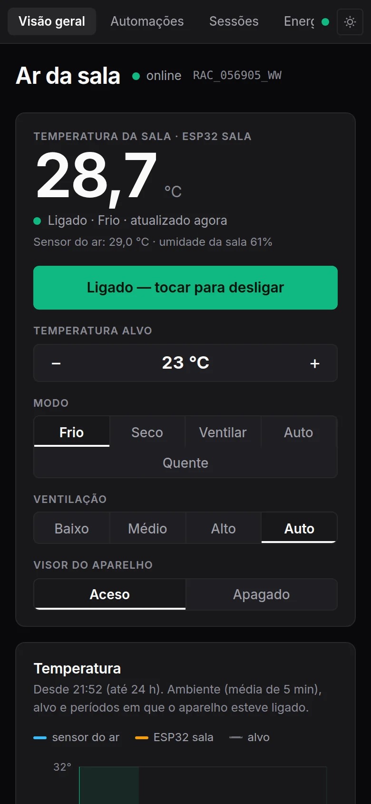

<div align="center">

# AC Control

**Controle, automações seguras e custo de energia para ar-condicionado LG ThinQ.**




</div>

O app da LG liga, desliga e muda a temperatura. Ele não liga o ar sozinho quando a sala esquenta, não guarda histórico seu e não diz quanto você gastou. O AC Control faz isso: conversa com a API oficial da LG (ThinQ Connect), guarda tudo em um SQLite local e roda como um único processo, sem depender de nuvem de terceiros.

## Índice

[Telas](#telas) · [Início rápido](#início-rápido) · [Estrutura do repositório](#estrutura-do-repositório) · [Tecnologias](#tecnologias) · [Configuração](#configuração) · [Documentação](#documentação)

---

## Telas

### Visão geral

Estado do aparelho em tempo real e tudo o que importa no dia: temperatura da sala, ligar/desligar, temperatura alvo, modo e ventilação, o gráfico das últimas 24 h (a faixa verde marca quando o ar esteve ligado), as automações ativas, as sessões recentes, os últimos comandos enviados e o quanto do orçamento do mês já foi gasto. O estado chega pelo MQTT da LG e é empurrado ao navegador por SSE, sem recarregar a página.



### Automações

Regras no formato **quando → então → até → depois**. Exemplo: *quando passar de 27 °C por 10 minutos, entre 20h e 6h, ligar em modo frio a 23 °C; ficar até chegar a 24 °C; depois desligar.* Ao criar ou editar, o servidor valida a regra e mostra, em português, o que ela vai fazer ("Como vai funcionar"). Regras perigosas são recusadas (sem temperatura de saída, sem tempo máximo, sem folga entre ligar e desligar). Se você mexer no aparelho, as regras pausam por uma hora para não brigar com você.

<table>
<tr>
<td valign="top"></td>
<td valign="top" width="38%"></td>
</tr>
</table>

Detalhes das condições e proteções em [`docs/automacoes.md`](docs/automacoes.md).

### Sessões

Uma **sessão** é o período entre o aparelho ligar e desligar. Cada linha mostra início, duração, temperatura inicial → final, alvo, modo, **origem** (Automação, Manual pelo painel, App/controle da LG, ou "Já estava ligado" quando o app começou a monitorar com o ar ligado), consumo e custo. A LG informa o consumo por dia e não por sessão; por isso o valor de cada sessão é sempre **ESTIMADO**: o app reparte o consumo do dia entre as sessões pelo tempo ligado (ou pela diferença do contador da LG, quando há leituras próximas). Se o dia ainda não fechou, o valor vem marcado como provisório.



### Energia

Consumo informado pelo próprio aparelho, em kWh, com custo em R$: hoje, ontem, últimos 7 dias, mês até agora, **projeção do mês** (comparada à sua meta) e mês anterior (com o mesmo mês do ano passado). Os gráficos mostram consumo por dia (30/60/90 dias), média por dia da semana, acumulado do mês contra o mês anterior e consumo por mês. Todo número leva o selo **MEDIDO** (vem do aparelho) ou **ESTIMADO** (calculado aqui).



Como o consumo é medido e estimado: [`docs/energia-e-sessoes.md`](docs/energia-e-sessoes.md).

### Configurações

- **Tarifa de energia**: preço do kWh com data de início. Cada dia usa a tarifa vigente nele, então mudar o preço não reescreve o custo do passado.
- **Meta do mês**: orçamento em R$ para comparar com a projeção.
- **Consumo estimado (opcional)**: potência média, usada só se o aparelho não informar consumo.
- **Sensores externos (opcional)**: veja abaixo.



### Sensor externo ESP32 (opcional)

Tudo funciona só com o sensor do próprio ar-condicionado. Se você tiver um ESP32 com sensor de temperatura e umidade (DHT) servindo um JSON na rede local, o AC Control consulta a cada 30 s e passa a mostrar a temperatura e a umidade reais da sala no painel e no gráfico. As automações podem usar essa temperatura no lugar da do aparelho, que costuma ler o ar junto ao split. Contrato e passo a passo em [`docs/sensor-esp32.md`](docs/sensor-esp32.md).

### Tema claro e escuro

O tema padrão é escuro. O botão no topo do menu lateral (ou da barra, no celular) alterna para o claro; a escolha fica salva no navegador e é aplicada antes da primeira pintura, sem piscar.

<table>
<tr>
<td></td>
<td></td>
</tr>
</table>

### Celular

O layout se adapta: o menu lateral vira uma barra rolável no topo e os cartões empilham.



---

## Início rápido

Requisitos: **Node 20+** e **pnpm 10** (`corepack enable` já ativa). Para Docker: Docker com Compose.

### 1. Sem aparelho (aparelho simulado)

```bash
pnpm install
pnpm build                                                    # gera a UI em apps/web/dist
PROVIDER=fake WEB_DIR=apps/web/dist pnpm dev:api              # abra http://127.0.0.1:8080
```

Para desenvolver a interface com recarga automática, em outro terminal: `pnpm --filter @acc/web dev` (http://localhost:5173, com proxy para a API). `pnpm check` roda tipos e testes.

### 2. Com o seu ar-condicionado LG

1. Crie um **PAT** em <https://connect-pat.lgthinq.com> marcando **todos os escopos** (inclui energia). É para uso pessoal, não comercial.
2. `cp .env.example .env` e preencha `LG_PAT` (e `LG_COUNTRY`, ex.: `BR`). O `.env` não é versionado.
3. Suba a API lendo o `.env`:

```bash
PROVIDER=lg-thinq WEB_DIR=apps/web/dist node --env-file=.env --import tsx apps/api/src/main.ts
```

Abra <http://127.0.0.1:8080>. Na primeira execução o app descobre o aparelho, registra o cliente MQTT, importa até 120 dias de energia e começa a guardar o histórico em `data/`.

### 3. Docker (servidor / homelab)

```bash
mkdir -p secrets
printf '%s' 'SEU_PAT' > secrets/lg_pat.txt
printf 'minha-senha' | pnpm -s hash-password > secrets/admin_password_hash.txt
docker compose up -d
```

A porta fica em `127.0.0.1:8080`. Para acessar de fora, coloque um proxy reverso com HTTPS ou uma VPN na frente e defina `COOKIE_SECURE=true`. O volume `/data` guarda banco, identificador do cliente e certificados MQTT. Saúde: `GET /healthz`, `GET /readyz`. Contrato da API: `GET /openapi.json`.

Fora de loopback a API **exige** senha (`ADMIN_PASSWORD_HASH`) ou `API_TOKEN` (bearer, para outros sistemas consumirem a API).

---

## Estrutura do repositório

```
apps/
  api/                 servidor Fastify: rotas HTTP e SSE, login, agendador, sensores, sessões, coleta de energia
  web/                 interface React (Vite), servida pela própria API em produção
packages/
  domain/              regras puras do negócio: estado do aparelho, regras de automação, tempo. Sem I/O
  contracts/           schemas Zod compartilhados entre API e UI (também geram o OpenAPI)
  provider-api/        a interface ACProvider: o que o app exige de qualquer fabricante
  providers/
    lg-thinq/          integração com a LG (REST, MQTT, perfil do aparelho, energia)
    fake/              aparelho simulado, para desenvolver, testar e demonstrar sem hardware
  storage/             SQLite (WAL), migrações SQL e consultas
  automation/          CommandGateway (porta única dos comandos) e motor de automações
  analytics/           tarifa, custo, energia por sessão e projeção do mês
test/                  testes que atravessam pacotes: regras de arquitetura e proteção contra vazar segredos
fixtures/lg/           respostas reais da API da LG (sanitizadas) usadas nos testes do provider
spikes/spike0/         scripts que sondam a API real da LG (rest, comandos, mqtt) e geram as fixtures
scripts/               utilitários, p. ex. gerar o hash da senha de login
docs/                  documentação detalhada e os prints deste README
Dockerfile · docker-compose.yml · .env.example
```

Gerados e ignorados pelo git: `data/` (banco e certificados do seu aparelho), `dist/` (build), `node_modules/`.

## Tecnologias

| Camada | Stack |
|---|---|
| Linguagem / runtime | TypeScript (strict), Node.js 20+ (imagem Docker em Node 22) |
| Monorepo / build | pnpm workspaces, esbuild (bundle da API), tsx (desenvolvimento) |
| API | Fastify, Zod (validação e OpenAPI 3.1), helmet, rate-limit, cookies, SSE para tempo real |
| Banco | SQLite (WAL) via `better-sqlite3`, migrações em SQL |
| Aparelho | LG ThinQ Connect API: REST + MQTT com mTLS (`mqtt`, certificado gerado com `node-forge`) |
| Sensor | ESP32 + DHT consultado por HTTP (JSON), opcional |
| Interface | React, Vite, CSS próprio com tema claro/escuro, fonte Inter, gráficos em SVG |
| Testes | Vitest: domínio, automações, custo, API, contrato do provider e regras de arquitetura |
| Deploy | Docker multi-stage e Compose com secrets, usuário não-root, filesystem somente leitura |

## Configuração

Variáveis de ambiente (as terminadas em `_FILE` leem de arquivo/secret):

| Variável | Padrão | Para quê |
|---|---|---|
| `PROVIDER` | `lg-thinq` se houver PAT, senão `fake` | origem dos dados do aparelho |
| `LG_PAT` / `LG_PAT_FILE` | — | token pessoal da LG |
| `LG_COUNTRY` | `BR` | país da conta LG |
| `HOST` / `PORT` | `127.0.0.1` / `8080` | endereço do servidor |
| `DATA_DIR` | `./data` | banco, certificados MQTT, identificador do cliente |
| `USER_TZ` | `America/Sao_Paulo` | fuso para "hoje", "ontem" e o mês |
| `ADMIN_PASSWORD_HASH` / `_FILE` | — | senha do painel (obrigatória fora de loopback) |
| `API_TOKEN` | — | token bearer para outros sistemas usarem a API |
| `COOKIE_SECURE` | `false` | `true` quando servido por HTTPS |
| `WEB_DIR` | — | pasta da UI buildada, servida pela API |
| `LOG_LEVEL` | `info` | nível de log |

## Documentação

- [`docs/arquitetura.md`](docs/arquitetura.md): camadas, fluxos, proteções, banco e API.
- [`docs/automacoes.md`](docs/automacoes.md): como as regras funcionam e quais limites existem.
- [`docs/energia-e-sessoes.md`](docs/energia-e-sessoes.md): de onde vem o consumo, medido x estimado, tarifa e projeção.
- [`docs/sensor-esp32.md`](docs/sensor-esp32.md): sensor externo opcional.
