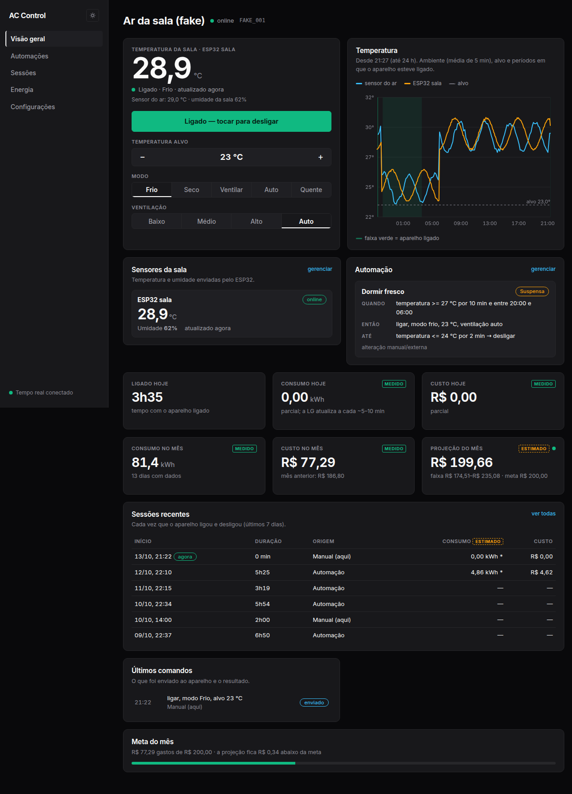
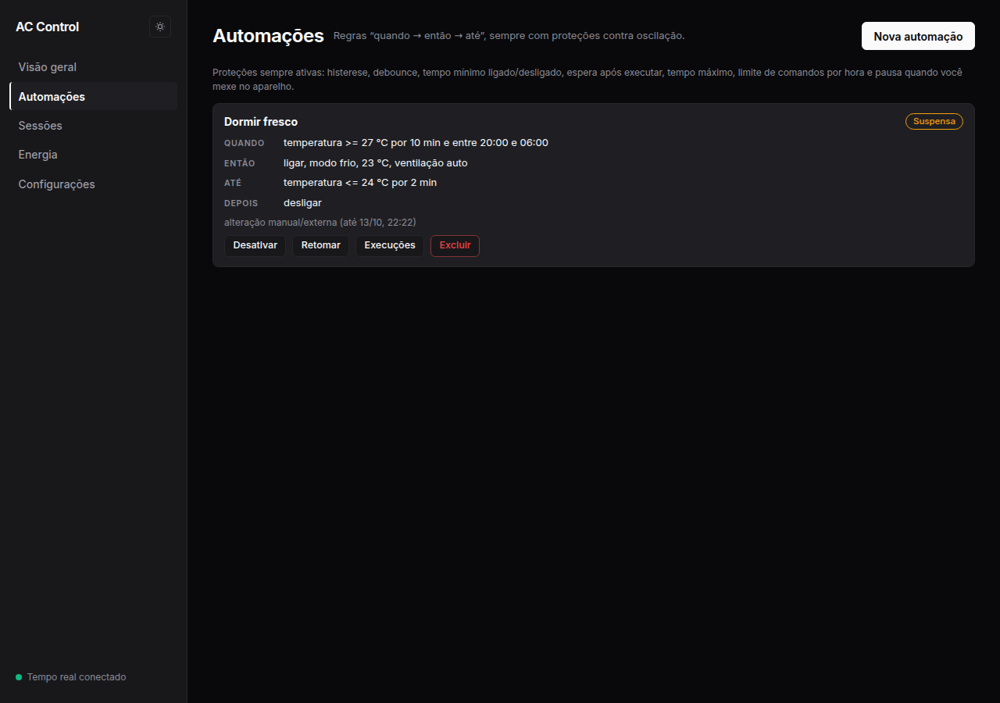
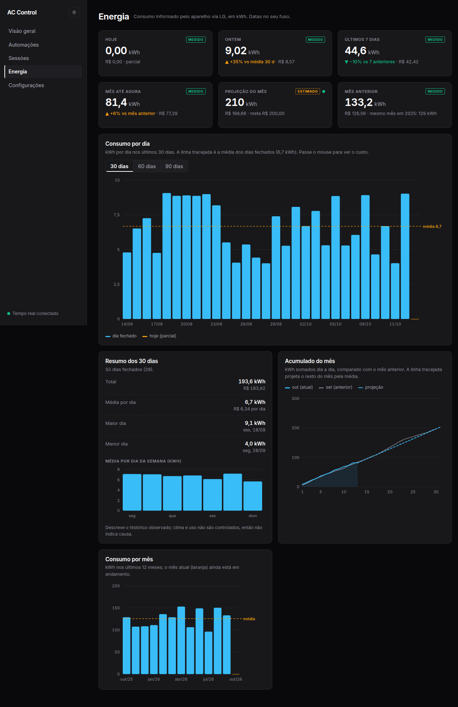
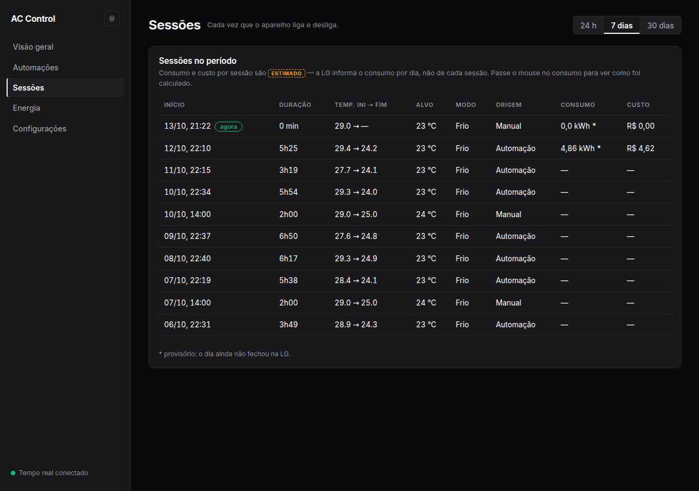
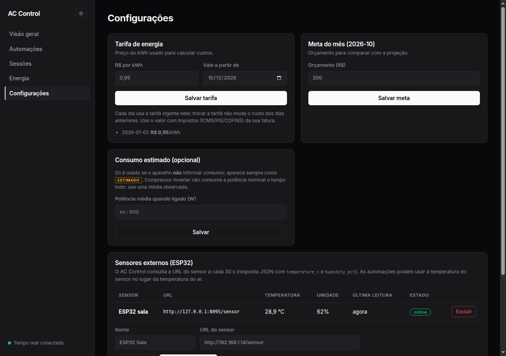

# AC Control

Camada inteligente sobre o ar-condicionado **LG ThinQ**: controle, automações seguras, histórico próprio, energia e custo em R$. Roda sozinho, em um container, para uso pessoal.



| | |
|---|---|
|  |  |
|  |  |

> Prints gerados com o aparelho simulado (`PROVIDER=fake`) e dados de demonstração.

## O que faz

- **Controle**: ligar/desligar, temperatura alvo, modo e ventilação, com estado em tempo real (MQTT da LG + SSE no navegador).
- **Automações** "quando → então → até", p. ex. *ligar às 20h se passar de 27 °C, desligar ao chegar a 24 °C*. Sempre com histerese, tempo máximo, cooldown, limite de comandos/hora e pausa quando você mexe no aparelho.
- **Sensor externo** (ESP32 + DHT): temperatura/umidade da sala como fonte das automações e do gráfico.
- **Sessões**: cada vez que o ar ligou e desligou, com duração, origem e consumo estimado.
- **Energia e custo**: kWh/dia/mês informados pela LG, tarifa versionada, projeção do mês e meta. Todo valor vem rotulado **MEDIDO** (do aparelho) ou **ESTIMADO** (calculado aqui).

## Tecnologias

| Camada | Stack |
|---|---|
| Linguagem / runtime | TypeScript (strict), Node.js 20+ (imagem Docker em Node 22) |
| Monorepo / build | pnpm workspaces, esbuild (bundle da API), tsx (dev) |
| API | Fastify, Zod (validação e OpenAPI 3.1), `@fastify/helmet`, `@fastify/rate-limit`, `@fastify/cookie`, SSE para tempo real |
| Banco | SQLite (WAL) via `better-sqlite3`, migrações em SQL |
| Aparelho | LG ThinQ Connect API (REST + MQTT/mTLS com `mqtt`, certificado gerado com `node-forge`) |
| Sensor | ESP32 + DHT consultado por HTTP (JSON) |
| Frontend | React, Vite, CSS próprio, fonte Inter, gráficos em SVG |
| Testes | Vitest (171 testes: domínio, automações, custo, API, contrato do provider, regras de arquitetura) |
| Deploy | Docker multi-stage, Docker Compose com secrets, usuário não-root, filesystem somente leitura |

## Onde roda

| Cenário | Como |
|---|---|
| Teste sem aparelho | `PROVIDER=fake` (aparelho simulado) |
| Desenvolvimento / uso local | Node 20+ com `PROVIDER=lg-thinq` e o `.env` |
| Servidor/homelab | Docker (`docker compose up -d`), porta `127.0.0.1:8080`, atrás de proxy reverso ou VPN com HTTPS |

Um processo só: API (Fastify) + UI (React, servida pela própria API) + SQLite em `/data`. A nuvem LG é a única dependência externa; o sensor ESP32 é consultado pela rede local.

## Rodar

```bash
pnpm install
PROVIDER=fake pnpm dev:api        # API em http://127.0.0.1:8080 com aparelho simulado
pnpm --filter @acc/web dev        # UI em http://localhost:5173 (proxy para a API)
pnpm check                        # tipos + testes
```

Servir a UI pela própria API: `pnpm build` e `WEB_DIR=apps/web/dist PROVIDER=fake pnpm dev:api`.

### Com o aparelho LG

1. Crie um PAT em <https://connect-pat.lgthinq.com> **marcando todos os escopos** (inclui energia). Uso pessoal/não comercial.
2. `cp .env.example .env` e preencha `LG_PAT` (o `.env` não é versionado).
3. `PROVIDER=lg-thinq WEB_DIR=apps/web/dist node --env-file=.env --import tsx apps/api/src/main.ts`

### Docker

```bash
mkdir -p secrets
printf '%s' 'SEU_PAT' > secrets/lg_pat.txt
printf 'minha-senha' | pnpm -s hash-password > secrets/admin_password_hash.txt
docker compose up -d
```

Volume `/data` guarda banco, `x-client-id` e certificados MQTT. `GET /healthz`, `/readyz`, `/openapi.json`. Fora de loopback a API exige senha (`ADMIN_PASSWORD_HASH`) ou `API_TOKEN` (bearer, para outros sistemas consumirem a API).

### Sensor ESP32

Em **Configurações → Sensores**, informe a URL do ESP32. O AC Control consulta a cada 30 s e espera JSON:

```json
{ "status": "ok", "temperature_c": 28.7, "humidity_pct": 61 }
```

## Configuração (variáveis de ambiente; `*_FILE` lê de arquivo/secret)

`HOST` (127.0.0.1), `PORT` (8080), `DATA_DIR`, `USER_TZ`, `PROVIDER` (`fake`|`lg-thinq`), `LG_PAT`, `LG_COUNTRY`, `ADMIN_PASSWORD_HASH`, `API_TOKEN`, `COOKIE_SECURE`, `WEB_DIR`, `LOG_LEVEL`.
