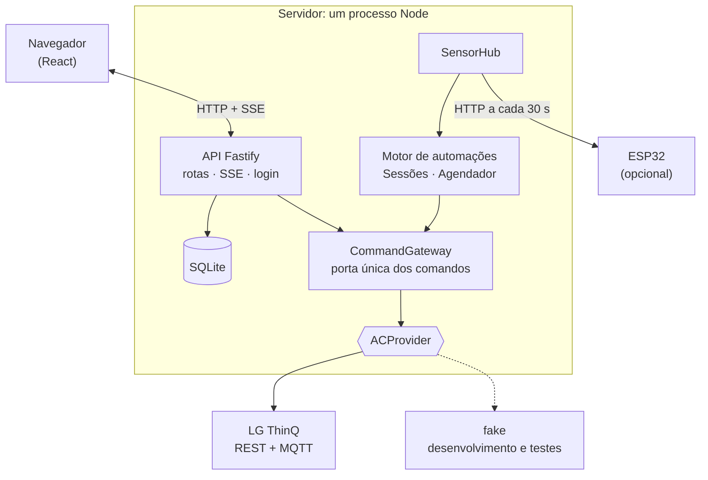
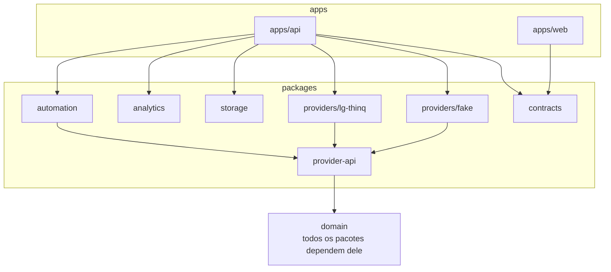
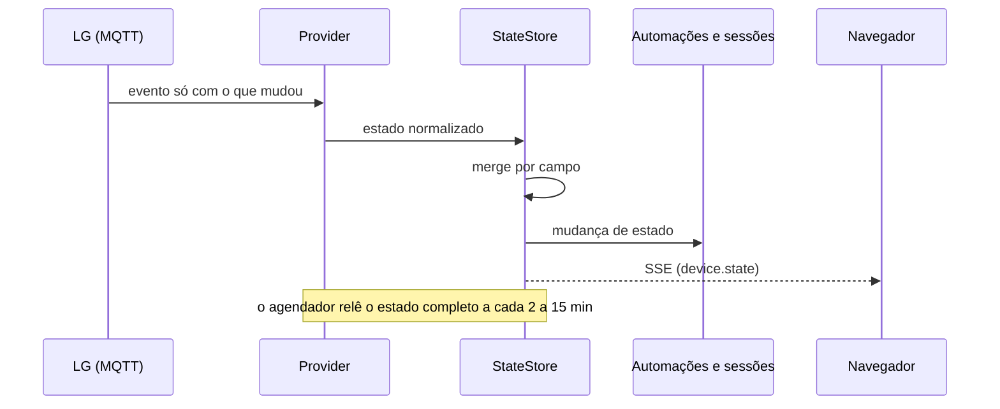
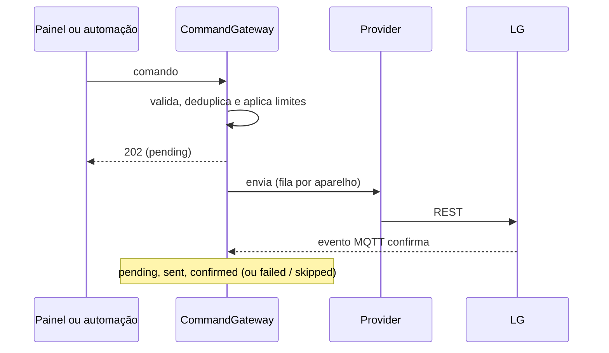

# Arquitetura

Um único processo Node: API Fastify, interface React estática e SQLite. O mapa de pastas está no [README](../README.md#estrutura-do-repositório).

## Dependências entre pacotes

As setas apontam para o que o pacote usa. `domain` não depende de ninguém, e `contracts`, `storage`, `analytics` e `automation` também o usam.

Duas regras são verificadas em `test/architecture.test.ts`:

- só `providers/lg-thinq` importa código da LG;
- só o `CommandGateway` chama `setAttributes` do provider. Nenhuma rota nem automação fala com o aparelho por outro caminho.

## Fluxos

### Estado do aparelho

O MQTT da LG envia só os campos que mudaram. O `StateStore` junta cada campo ao que já sabia e guarda quando o viu pela última vez. Um polling de reconciliação (2 min com regra armada ou em execução, 15 min com MQTT saudável, 10 min sem; até 30 min com backoff) cobre mensagens perdidas, e ao reconectar o MQTT o estado é relido por completo.

### Comando

Vale para o painel e para as automações. `POST /api/v1/devices/:id/commands` responde 202 na hora e o comando segue em segundo plano.

Se o evento de confirmação não chegar, o estado é relido para confirmar.

### Automação

O motor reavalia as regras a cada evento de estado e a cada minuto. Detalhes em [automacoes.md](automacoes.md).

### Energia e sessões

Em [energia-e-sessoes.md](energia-e-sessoes.md).

## Proteções do CommandGateway

Validação contra o perfil do aparelho (faixa e passo de temperatura, modos e ventilações aceitos), deduplicação (comando que não muda nada é descartado), chave de idempotência, tempo mínimo ligado e desligado, intervalo mínimo entre comandos, teto de comandos por hora, *circuit breaker* (estourou o teto: pausa as regras do aparelho; `POST /devices/:id/breaker/reset` libera) e detector de liga/desliga repetido. Comandos feitos pelo painel respeitam deduplicação, validação e teto, mas não o tempo mínimo ligado/desligado.

## Segurança

- A API escuta em `127.0.0.1`. Fora de loopback ela só sobe com `ADMIN_PASSWORD_HASH` (hash scrypt) ou `API_TOKEN`.
- Login por cookie `HttpOnly` + `SameSite=Strict`; métodos que alteram dados exigem o cabeçalho `x-requested-with`; rate limit em `/auth/login`; `helmet` com CSP estrita.
- O PAT da LG vem só de variável de ambiente ou secret e é removido dos logs. O certificado MQTT e a chave privada ficam em `DATA_DIR/lg`, fora do banco.
- URLs de sensor são consultadas com timeout de 5 s, sem seguir redirecionamentos, com corpo limitado a 8 KB.

## Banco (SQLite, WAL)

| Tabela | Conteúdo |
|---|---|
| `device`, `capability_snapshot` | aparelhos e o que cada um suporta |
| `reading` | leituras de estado (só quando muda, mais um batimento) |
| `event_raw` | eventos MQTT brutos e sanitizados |
| `command` | comandos, origem, estado e latência |
| `rule`, `rule_state`, `rule_run` | automações, estado atual e execuções |
| `session` | períodos ligado → desligado |
| `energy_daily`, `energy_monthly`, `energy_snapshot` | consumo informado pela LG |
| `tariff`, `goal` | preço do kWh por vigência e meta mensal |
| `sensor`, `sensor_reading` | sensores externos e suas leituras |
| `setting`, `auth_session` | preferências e sessões de login |

Tempos em milissegundos UTC. Datas de energia no fuso `USER_TZ`. Migrações em `packages/storage/migrations`. Um job diário apaga eventos brutos com mais de 14 dias, leituras e leituras de sensor com mais de 90 dias e agregados horários com mais de 2 anos; sessões, comandos e energia ficam para sempre.

## API

Prefixo `/api/v1`: `devices` (estado, `commands`, `history`, `sessions`, `energy`, `costs`, `projection`, `dashboard`), `tariff`, `goals`, `automations` (CRUD, `validate`, `enable|disable|resume`, `runs`), `sensors` (CRUD, `test`, `readings`), `settings/estimate`, `auth`, `events/stream` (SSE). Fora do prefixo: `/healthz`, `/readyz`, `/openapi.json`. Erros seguem `application/problem+json`. O contrato completo está em `/openapi.json`.
