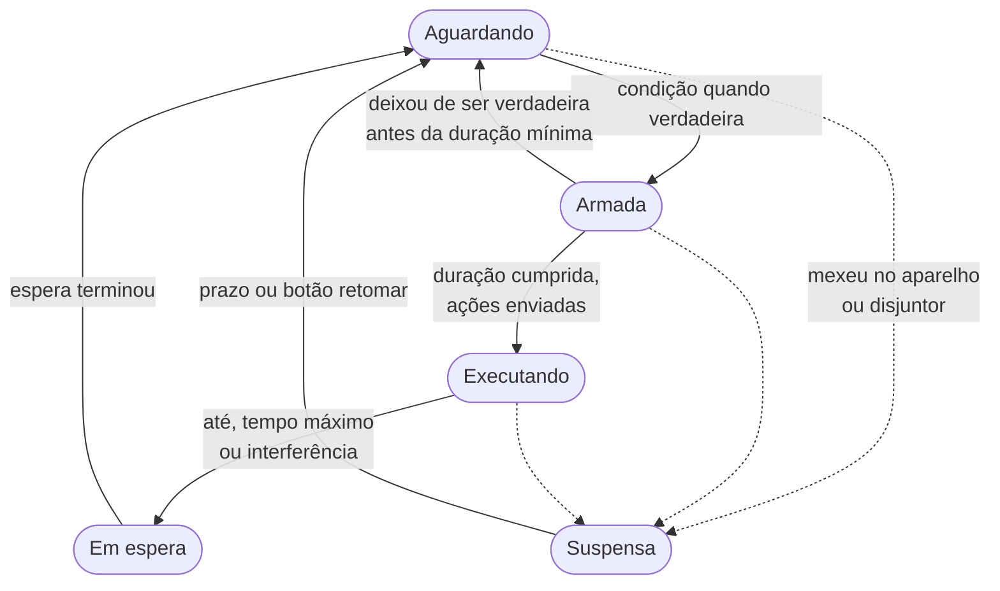

# Automações

Uma automação liga e desliga o aparelho sozinha, sempre com limites que impedem que ela fique oscilando ou ligada para sempre.

## Anatomia

| Parte | Função | Exemplo |
|---|---|---|
| **Quando** | condição para começar | temperatura ≥ 27 °C por 10 min, entre 20:00 e 06:00 |
| **Então** | o que enviar ao aparelho | ligar, modo frio, 23 °C, ventilação automática, apagar o visor |
| **Até** | condição para terminar | temperatura ≤ 24 °C por 2 min |
| **Depois** | o que fazer ao terminar | desligar |

Condições disponíveis: temperatura (com duração mínima), janela de horário (pode atravessar a meia-noite), dias da semana, estado do aparelho e tempo ligado, combináveis com `all`, `any` e `not`. A temperatura pode vir do sensor do ar-condicionado ou de um [sensor externo](sensor-esp32.md).

## Estados

- **Armada**: a condição "quando" é verdadeira e está contando a duração mínima. Se deixar de ser verdadeira antes, volta a Aguardando.
- **Executando**: a regra executou e o aparelho está sob o controle dela até a condição "até", o tempo máximo ou uma interferência.
- **Em espera** (cooldown): depois de terminar, a regra espera antes de poder disparar de novo.
- **Suspensa**: pausada por alteração manual ou pelo disjuntor (*circuit breaker*, que corta as regras quando o aparelho recebe comandos demais). Volta sozinha depois do prazo ou pelo botão de retomar.

O estado é gravado no banco a cada transição; reiniciar o servidor no meio de uma execução retoma de onde estava.

## De onde vem a temperatura

A regra pode usar o sensor do próprio ar-condicionado ou um [sensor externo (ESP32)](sensor-esp32.md). Os dois não são equivalentes:

| | Sensor do ar-condicionado | ESP32 |
|---|---|---|
| **Desligar** quando a temperatura baixar ("até") | Funciona. Com o aparelho ligado ele informa a cada poucos minutos | Funciona, com leitura a cada 30 s |
| **Ligar** quando a temperatura subir ("quando") | **Não funciona de forma confiável.** Desligado, o aparelho não atualiza a temperatura e a leitura fica parada | Funciona |
| Umidade da sala | Não (este modelo não tem sensor de umidade) | Sim |

Resumo: com o sensor do ar, use regras que só desligam. Para ligar o ar por temperatura é preciso um ESP32. O formulário de nova automação avisa quando uma regra que liga o aparelho está usando o sensor do ar.

## Proteções

Toda regra tem estes limites, validados ao salvar. O formulário usa os valores padrão e o servidor recusa o que ultrapassa o teto.

| Limite | Padrão | Regra |
|---|---|---|
| Tempo máximo ligada | 8 h | no máximo 12 h |
| Espera após terminar | 30 min | — |
| Tempo mínimo ligado | 10 min | no mínimo 3 min |
| Tempo mínimo desligado | 5 min | no mínimo 3 min |
| Comandos por hora | 6 | no máximo 20 |
| Pausa após mexer no aparelho | 1 h | — |
| Histerese (entrada x saída) | — | no mínimo 1 °C |

Além disso, uma regra que **liga** o aparelho precisa de condição "até" e de ação "depois". Exemplo de recusa: `histerese insuficiente: entrada 25 e saída 24.5 (mín. 1 °C)`.

## Interferência manual

Se o aparelho mudar sem um comando do app que explique (você usou o controle remoto, o app da LG ou o painel), as regras daquele aparelho entram em **Suspensa** pelo tempo de "pausa após mexer". O painel mostra o motivo e permite retomar.

## Prioridade e conflitos

Cada aparelho tem no máximo uma regra em execução por vez. Se duas regras podem disparar, a de maior prioridade assume; empate vai para quem armou primeiro. A regra que perdeu a vez termina com o motivo "outra regra assumiu".

## Temperatura desatualizada

A leitura de temperatura do aparelho pode demorar vários minutos para chegar. Se a última leitura for mais velha que 20 minutos (ou o sensor externo parar de responder), a condição de temperatura fica **desconhecida**: nem verdadeira nem falsa. Uma regra em execução continua até o tempo máximo, mas nenhuma regra nova dispara.

## Execuções

Cada vez que uma regra termina, o painel registra início, fim e o motivo: chegou na temperatura de saída, tempo máximo, você mexeu no aparelho, outra regra assumiu, aparelho desligado, bloqueada por proteção ou não conseguiu desligar.
