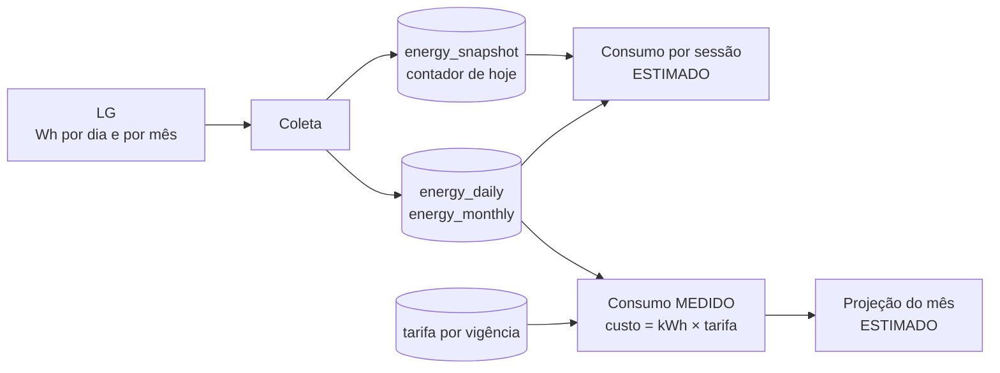

# Energia, sessões e custo

## O que a LG informa

A API da LG devolve o consumo do aparelho em **Wh por dia** e **por mês**. Ela não informa potência instantânea (W) nem consumo por sessão. Tudo o que o painel mostra a mais disso é cálculo do AC Control e vem marcado.

| Selo | Significado | Exemplos |
|---|---|---|
| **MEDIDO** | número informado pelo aparelho | consumo de ontem, do mês, custo (Wh × tarifa) |
| **ESTIMADO** | calculado aqui | consumo por sessão, projeção do mês |

## Coleta

- **Primeira execução:** importa até 120 dias de histórico.
- **Hoje:** o contador do dia sobe em degraus de 5 a 10 minutos. O app o lê a cada 10 min com o aparelho ligado, de hora em hora desligado, e faz uma leitura final cerca de 11 min depois de desligar, para fechar a energia da sessão. Cada leitura fica em `energy_snapshot`.
- **Dias e meses recentes:** relidos uma vez por dia, em um horário sorteado de madrugada, para pegar o fechamento do dia. Um dia só é marcado como final depois disso.
- **Sem suporte ou sem escopo:** se o aparelho não responder energia ou o PAT não tiver o escopo, o app para de tentar por 24 h em vez de insistir.

## Custo

`custo = kWh × tarifa vigente no dia`. A tarifa é versionada por data de início: mudar o preço vale a partir da data informada e não altera os dias anteriores. O custo não é gravado; é calculado na hora, então corrigir uma tarifa recalcula o histórico. Use o valor da fatura com impostos.

## Projeção e meta

A projeção do mês soma o que já foi consumido e completa os dias restantes com a média diária, com uma faixa mínima e máxima. É sempre **ESTIMADO**. Se houver meta para o mês, o painel compara a projeção com ela.

## Sessões

Uma sessão começa quando o aparelho liga e termina quando desliga. Sessões que atravessam a meia-noite são divididas por dia nos cálculos. A origem é:

| Origem | Quando |
|---|---|
| Automação | foi uma regra que ligou |
| Manual | você ligou pelo painel |
| App/controle | o aparelho ligou por fora (app da LG, controle remoto) |
| Já estava ligado | o app começou a monitorar com o aparelho ligado |

Se o app reiniciar com uma sessão aberta, ela é retomada; se o aparelho foi desligado enquanto o app estava fora, a sessão é fechada com essa informação.

### Consumo por sessão

Como a LG só dá o total do dia, o consumo de cada sessão é estimado de dois jeitos:

1. **Pela diferença do contador do dia** (`snapshot_delta`): usa as leituras do contador perto do início e do fim da sessão. É o método mais preciso, com margem de cerca de 10 minutos.
2. **Proporcional ao tempo ligado** (`proportional`): divide o consumo do dia entre as sessões do dia pelo tempo de cada uma. É o método de reserva.

A estimativa é descartada (aparece "—" com o motivo ao passar o mouse) quando:

- o app só começou a monitorar depois do início do dia, porque o total inclui horas que ele não viu;
- o aparelho já estava ligado quando o app começou a monitorar;
- o resultado implica mais de 3,5 kW de potência média, o que não é plausível para um split residencial;
- não há energia medida para o dia.

Valores de um dia que ainda não fechou aparecem com `*` (provisório) e são recalculados quando o dia fecha.

### Consumo estimado manual

Em **Configurações → Consumo estimado**, você pode informar uma potência média (W). Ela só é usada se o aparelho não informar consumo, e sempre aparece como ESTIMADO. Um compressor inverter não consome a potência nominal o tempo todo, então use uma média observada.
